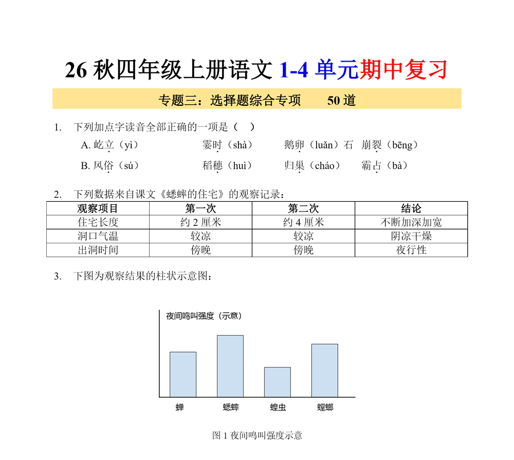

# dsh-docx-from-images

把截图 / 扫描件里的试卷、讲义重新排成 **排版一致的 Word 文档** —— 这是 DeepSeek Harness 的一个 Host 插件（bundle），
提供三个工具和一份技能（skill），并把 OOXML 排版里最容易踩的几个坑全部内置规避。

> Screenshot → Word typesetting plugin for DeepSeek Harness. Three tools (`docx_typeset`, `docx_crop`, `docx_ocr`) and one skill (`image-to-docx`).



## 提供的能力

| 名称 | 类型 | 作用 |
| --- | --- | --- |
| `docx_typeset` | Tool | 按 JSON spec 生成 `.docx`：着重号、制表位列（2/4 栏选项）、色带标题、**表格**、**插图**、显式分页；生成前会估算列宽并返回 warning |
| `docx_crop` | Tool | 从截图/拍照件里裁插图：像素框裁剪、去白边、放大、网格预览；**纸底美白**（`white_point`）、**可调墨迹阈值**（`trim_threshold`）、**多联图拼合**（`compose` + `panels`） |
| `docx_ocr` | Tool | 把图**读成文字**：每一行带 bbox 坐标（模型看不见图时唯一可靠的转写依据）；`figures:true` 还会报告"文字行之间仍有墨迹的空白带"= 插图位置 |
| `image-to-docx` | Skill | 端到端流程：探图 → 逐图转写 → 标格式 → 写 spec → 生成 → 目视验收 → 交付话术 |

## 安装

需要本机有 Python 3 + `python-docx` + `Pillow`。插件会依次尝试：
`$DSH_PYTHON` → `$DSH_HOME/dsh-runtimes/*/dependencies/python` → `$HOME/.dsh/...` → PATH 上的 `python`。

`docx_ocr` 走的是 Windows 自带的 OCR 引擎（`Windows.Media.Ocr`），**仅 Windows**，并且需要装了
`zh-Hans-CN` 语言包；其他平台上该工具会直接报错，`docx_typeset` / `docx_crop` 不受影响。

```powershell
# 把仓库放到任意目录，然后在 Harness 里用 plugin_manager 安装这个目录
plugin_manager({ action: "install_bundle", target: "<本仓库绝对路径>" })
```

装好后：

- 工具出现在 Agent 的工具列表里（`docx_typeset` / `docx_crop` / `docx_ocr`）；
- 技能目录里多出 `image-to-docx`，用户说“把这几张截图排成 Word”时会自动加载；
- 插件面板里的标题与图标来自 `locale/zh.json`、`locale/en.json` 与 `icon.svg`。

## 用法

```
docx_typeset({
  spec: {
    out: "D:/out/试卷.docx",
    page: { margin_cm: { top: 2.2, bottom: 2.2, left: 2.2, right: 2.2 } },
    body: { font: "宋体", latin: "Times New Roman", size_pt: 12, line_pt: 20 },
    blocks: [
      { type: "text", text: "1.\t下列加点字读音全部正确的一项是{b}（　）{/b}", tabs_cm: [0.78], before_pt: 7 },
      { type: "text", text: "A.\t屹{d}立{/d}（yì）\t霎{d}时{/d}（shà）", tabs_cm: [6.05, 9.4], indent_cm: 1.1 }
    ]
  }
})
```

块类型：`title` / `text` / `table` / `image` / `pagebreak`。
文本标记：`{d}着重号{/d}`、`{b}加粗{/b}`、`{i}斜体{/i}`、`{u}下划线{/u}`；`\t` 开一个新列。
完整示例见 [`examples/spec.json`](examples/spec.json)。

### 混排与页脚

一份卷子里常常“题干宋体、材料楷体、标题微软雅黑”，所以每个 `text` / `title` 块都能单独指定字体：

```json
{ "type": "text", "text": "①夜深了，人们睡了……", "font": "楷体", "first_line_cm": 1.06 }
```

页脚用 `{page}` / `{pages}` 占位，写入的是真正的 PAGE / NUMPAGES 域（合并多张图后页数自动正确）：

```json
"footer": { "text": "第 {page} 页 共 {pages} 页", "size_pt": 9, "align": "center" }
```

`body.dot_min_line_pt`（默认 24）控制带着重号的行至少多高；字号偏小时（≤13pt）调到 21–22 既能保住点，又不会把版面撑到多出一页。

## 内置规避的坑

| 坑 | 现象 | 本插件的做法 |
| --- | --- | --- |
| 着重号画在字上 | `w:em val="dot"` 把点画在字顶 | 强制 `val="underDot"`；也不拿“下划线”冒充 |
| 着重号被裁一半 | 行距“固定值”时字下方的点被切掉 | 含 `{d}` 的行自动升到 `body.dot_min_line_pt`（默认 24pt） |
| 字号拍脑袋 | 定大一号就每题多折一行，9 页排成 13 页 | 从截图反推单字宽（行宽 ÷ 字数），再以“分页是否与原图一致”验收 |
| 材料与题干同字体 | 楷体引文排成宋体一眼假 | 段落级 `font` / `latin` 覆盖 `body` |
| 页脚写死页数 | “共 27 页”在合并稿里全错 | `footer` 里的 `{page}` / `{pages}` 写成域代码 |
| 页边一排 ■ | 段落设了“与下段同页/段前分页/段中不分页” | 一律不写 `keepNext/keepLines/pageBreakBefore`；改在上一段末尾插分页符 |
| 表格后排不掉页 | 分页符落在表格前的段落上 | 表格后分页用 1pt 载体段承载 |
| 选项整行右移 | 行内标签 `A.\t` 只替换了第一个制表符 | 开头的 `A.\t` 自动归一成 `A. ` |
| 制表位叠加缩进 | 以为 `tabs_cm` 从首行缩进算起 | 制表位从**页面左边距**量起，并估算列宽给出溢出 warning |
| 插图糊 / 占满版心 | 直接塞整页截图 | 先用 `docx_crop` 裁图（去白边、2x 放大），再按版心比例给 `width_cm` |
| 拍照件的图带灰底 | 图贴进 Word 是一块灰方块，`trim` 也裁不掉任何边 | 纸底 ~200 灰、245 阈值看不见它：加 `white_point:true` + `trim_threshold:205`（详见下节） |
| 一题多联图被截成一张 | 一排三把尺子只贴出一把 | `compose:true` + `panels:[{box},…]`，横向用 `align:"bottom"` 共底线 |
| 手写混进插图 | 图里出现学生笔迹，与印刷内容黏在一起 | 抬高 `trim_threshold` 只按重墨收紧边界；或看墨迹逐行分布，把 `y1` 停在印刷内容结束处 |
| 表格手工空格对齐 | 列不齐、跨页表头丢失 | `Table Grid` + 显式列宽 + 表头跨页重复 |

## 拍照件的插图（`white_point` / `compose`）

截图是纯白底，拍照不是：手机拍的卷面**纸底约 200 灰**，于是默认 245 的 `trim` 阈值一个像素也裁不掉，图会带着整块灰底贴进 Word。三个参数解决：

```json
{
  "src": "page3.jpg",
  "out": "fig_wu.png",
  "compose": true,
  "panels": [
    { "box": [100, 560, 562, 756] },
    { "box": [640, 556, 1270, 758] }
  ],
  "white_point": true,
  "trim": true,
  "scale": 2,
  "align": "bottom",
  "gap": 48
}
```

- `white_point`：纸底映射成纯白。`true` 按直方图自动取（85 分位数再降一点），或显式给数值配 `black_point`（如 `195` / `60`）。设了它就自动转 8-bit 灰度——黑墨线稿更清爽，体积更小。
- `trim_threshold`：低于此值算墨迹。不设 `white_point` 时默认 245（老行为），设了则默认 205。想躲开淡淡的铅笔痕就把它调低。
- `compose` + `panels`：一个 `image` 块只能放一张图，而一道题常常是“一排三把尺子”或“左右两幅商品图”，所以在这里拼成一张。`align:"bottom"` 让共底线的联图不错位（横向），`"top"/"center"/"left"/"right"` 同理；`direction:"vertical"` 可改成竖排。

输出的 JSON 里带 `ink_box`（成品墨迹范围），四个角落应当是 255，可以用来判断美白是否真的生效。

## 读图：文字 + 坐标 + 插图位置（`docx_ocr`）

模型看不见图的时候，转写只能靠 OCR —— 而且必须是**带坐标**的 OCR，否则对不齐行、也分不清哪句话在图上方哪句话在图下方。`docx_ocr` 调 Windows 自带引擎（`Windows.Media.Ocr`）给出每行的 bbox：

```
docx_ocr({ src: "page1.jpg", scale: 2, white_point: true, figures: true })
```

返回（坐标一律落回**原图像素空间**，与 `scale` 无关）：

```json
{
  "lines": 49, "width": 1536, "height": 2162,
  "boxes": [ { "y0": 72, "y1": 118, "x0": 204, "x1": 1242, "text": "三年级上册数学真题测试卷苏教版" } ],
  "text": "三年级上册数学真题测试卷苏教版\n（期中测试卷）\n…",
  "figures": [ { "y0": 1064, "y1": 1204, "x0": 113, "x1": 1279, "w": 1166, "h": 140 } ]
}
```

几个关键点：

- **`figures` 是替代"用眼睛找图"的办法**：插图一定落在文字行之间的空白带里，所以"两行之间还有墨迹"的就是图。空白带本身没有墨迹的不算（用 `ink_bbox` 复核），页面上贯通上下的竖线（表格线、密封线）用 `drop_rules` 先剔掉，否则图框左边界会粘到那条线上。
- **中文归一化**：引擎会把每个汉字用空格隔开（`三 年 级…`），这里按"汉字—汉字 / 汉字—全角标点"的边界合并回去，而 `66 ÷ 3 + 3` 的间距保留。
- `region:[x0,y0,x1,y1]` 限定只读某块；卷面左侧有密封线时用它把那一栏排掉，比事后裁更省事。
- `scale:2` 对小字明显提准；`white_point` 对拍照件必开（见上一节）。
- 输出按 `y0`、`x0` 排序，读数顺序稳定（引擎原始顺序会在表格处乱跳）。

拿到 `figures` 的框就能直接喂给 `docx_crop`：`box` 参数与这里的 `[x0,y0,x1,y1]` 同构，先 `trim` 收一下再放大即可。

## 验证（可选，需要装有 Word）

```powershell
$w = New-Object -ComObject Word.Application; $w.Visible = $false
$d = $w.Documents.Open($docx, $false, $true)
$d.ExportAsFixedFormat($pdf, 17); $d.Close(0); $w.Quit()
```

再用 `Windows.Data.Pdf` 逐页 `RenderToStreamAsync`（`DestinationWidth = 1240`）出 PNG 目视比对。
注意 PowerShell 5.1 会把 `.ps1` 当 ANSI 读，脚本内容与路径保持纯 ASCII，中文路径用参数传。

## 目录结构

```
index.js        插件入口：注册 docx_typeset / docx_crop / docx_ocr / image-to-docx
builder.py      JSON spec -> .docx（python-docx）
crop.py         截取插图 / 纸底美白 / 多联图拼合 / 网格预览 / 尺寸探测（Pillow）
ocr.py          图像 -> 文字行 + bbox + 插图候选带（Pillow 预处理）
ocr_ps.ps1      Windows.Media.Ocr 的实际调用（纯 ASCII，PowerShell 5.1 兼容）
cordis.patch.yml  bundle 安装行
locale/{zh,en}.json  插件面板的标题与描述
icon.svg        插件图标
examples/       可直接运行的示例 spec 与插图
```

## License

MIT © wjx-ai